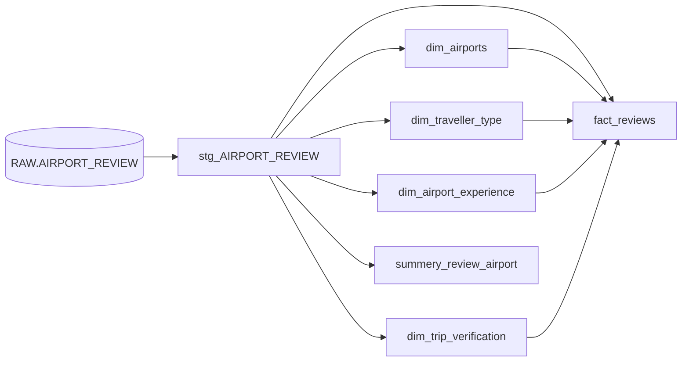

# Airport Reviews: dbt + Snowflake Project

A data cleaning and modeling project built with **dbt** on **Snowflake**.
It takes a raw CSV of airport reviews, cleans it, and turns it into a **star schema** that is ready for analysis.

## Tech Stack

- **Snowflake**: data warehouse
- **dbt (dbt-snowflake)**: transformations, testing, and documentation
- **Python virtual environment** (`.venv`) to run dbt

## The Data

- Source file: `all_airport_reviews.csv`
- About **43,988 reviews** for **927 airports**, 17 columns
- Loaded into Snowflake as `AIRPORT_DB.RAW.AIRPORT_REVIEW`
- Main columns: review title and text, review date, visit date, airport name, traveller type, experience at the airport, 8 rating columns (queuing, cleanliness, seating, signs, food, shopping, wifi, staff), and whether the traveller recommends the airport

## Project Structure

```
airport_data_project/
├── models/
│   ├── sources.yaml                  # tells dbt where the raw table is
│   ├── staging/
│   │   └── stg_AIRPORT_REVIEW.sql    # cleaning happens here
│   └── marts/
│       ├── dim_airports.sql
│       ├── dim_traveller_type.sql
│       ├── dim_airport_experience.sql
│       ├── dim_trip_verification.sql
│       ├── fact_reviews.sql
│       └── summery_review_airport.sql   # average ratings per airport
├── dbt_project.yml
└── README.md
```

## Data Flow



## Data Cleaning Steps (staging layer)

All cleaning is done in `models/staging/stg_AIRPORT_REVIEW.sql`.

| Column | Problem | What we did |
|---|---|---|
| `TITLE` | Wrapped in quotation marks (straight and curly) | Removed the quotes and extra spaces |
| `DATE` | Text like `16th September 2023` | Removed `th/st/nd/rd` and converted to a real `DATE` |
| `CONTENT` | Extra spaces, hidden new lines, special characters, leading symbols (❎ ❌ ✅), and a leading `Trip Verified\|` / `Not Verified\|` phrase | Cleaned all of them |
| `EXPERIENCE_AT_AIRPORT`, `DATE_VISIT`, `TYPE_OF_TRAVELLER` | Missing values written as the text `N/A` | Converted `N/A` to a real `NULL` |
| 8 rating columns | Stored as text, missing values written as `NA` | Converted to integers and `NA` to `NULL` |
| `AIRPORT_NAME` | Repeated spaces (for example `Hamad  Doha`) | Collapsed to a single space |
| All columns | 121 rows duplicated in every column | Removed with `DISTINCT` |

Result: **43,988 raw rows → 43,867 clean rows**.

## Data Model (marts layer)

A star schema with one fact table and four small dimension tables.

| Model | Rows | Description |
|---|---|---|
| `fact_reviews` | 43,867 | One row per review: keys to the dimensions, dates, review text, ratings, recommendation |
| `dim_airports` | 927 | One row per airport |
| `dim_traveller_type` | 5 | Couple / Solo / Family / Business / Unknown |
| `dim_airport_experience` | 5 | Arrival / Departure / both / Transit / Unknown |
| `dim_trip_verification` | 2 | Verified / Not Verified |
| `summery_review_airport` | | Review count and average rating per airport |

In the dimension tables, empty values are written as `Unknown`, so the joins in `fact_reviews` never lose rows.

## How to Run

1. Install dbt for Snowflake in a virtual environment:

   ```bash
   pip install dbt-snowflake
   ```

2. Add your Snowflake connection to `~/.dbt/profiles.yml`.
   This file contains credentials, so **never commit it to Git**.

3. Check the connection:

   ```bash
   dbt debug
   ```

4. Build everything:

   ```bash
   dbt run
   ```

5. Build one model and everything it depends on:

   ```bash
   dbt run --select +fact_reviews
   ```

6. Generate and open the documentation and the lineage graph:

   ```bash
   dbt docs generate
   dbt docs serve
   ```

## Known Decisions and Next Steps

- **Rating value `0`:** the rating scale is 1 to 5, but some rows contain `0`. It is unclear whether `0` means "not rated" or "very bad", so it is currently kept as is. Averages should be read with this in mind until it is decided.
- `DATE_VISIT` is kept as text (`September 2023`) because it only contains a month and a year.
- Add dbt tests (`not_null`, `unique`, `accepted_values`, `relationships`) in a `.yml` file.
- Move staging and marts models into their own schemas instead of `RAW`.
- Point `summery_review_airport` to `fact_reviews` and `dim_airports`, and fix the spelling of its name.
