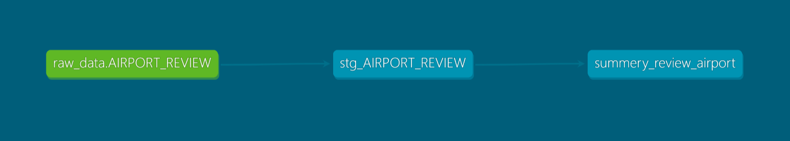

# Airport Reviews dbt Project

A dbt project that cleans a dataset of airport reviews (~44k rows) and turns it into a summary table per airport. Built on Snowflake.

## What it does

1. **Source**: raw airport reviews loaded into Snowflake (`raw_data.AIRPORT_REVIEW`).
2. **Staging** (`stg_AIRPORT_REVIEW`): cleans the raw data.
   - removes quotation marks from review titles
   - converts the review date from text to a real date
   - removes leading symbols and extra spaces from the review content
   - converts `N/A` values to `NULL`
   - converts rating columns from text to integers
   - removes duplicate rows
3. **Mart** (`summery_review_airport`): one row per airport (927 airports) with the number of reviews and the average ratings (queuing, cleanliness, food, wifi, staff).

## Lineage



## Tools

- dbt
- Snowflake

## How to run

```
dbt run
```