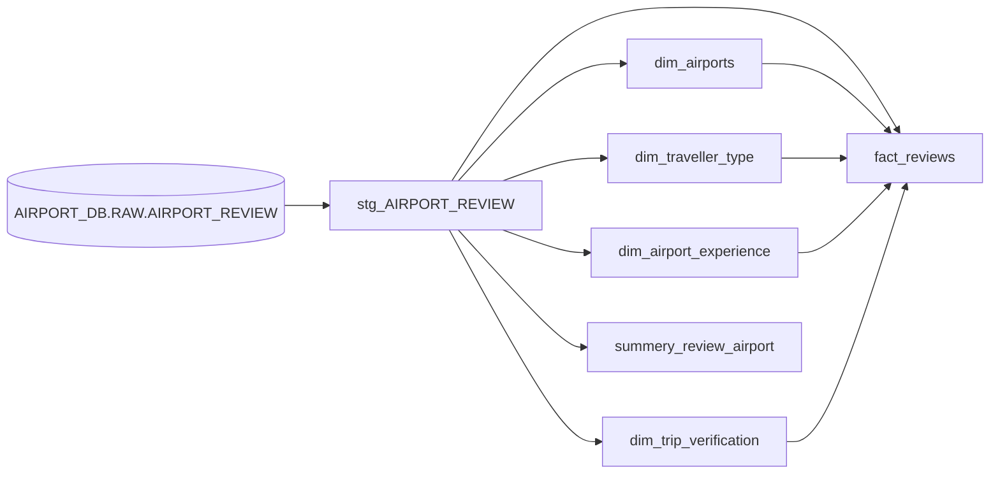

# Airport Reviews Analytics

An end-to-end analytics project that transforms raw airport reviews in Snowflake with dbt and presents the results in a Power BI dashboard.

## Project at a glance

- **Data warehouse:** Snowflake
- **Transformations and tests:** dbt Core with `dbt-snowflake`
- **Dashboard:** Power BI (`.pbix`)
- **Data model:** staging layer and dimensional marts, including a review fact table and lookup dimensions
- **Dashboard theme:** purple airport-inspired theme and custom logo

## Dashboard

Open [Airport Reviews Dashboard](reports/Airport-Reviews-Dashboard.pbix) in Power BI Desktop. The report has five pages:

| Page | What it shows |
|---|---|
| **Overview** | KPI cards, top airports by review count, review trend over time, and recommendations by traveller type |
| **Airports** | Airport-level review totals and comparisons between airports |
| **Travelers & Reviews** | Review distribution by traveller type, recommendations, and individual review details |
| **Service Ratings** | Airport service ratings, including queue times, cleanliness, seating, signs, food, shopping, Wi-Fi, and staff |
| **Trip Verification** | Verified and unverified review counts by airport and traveller type |

Airport and date slicers let report users explore different subsets of the data. Card and chart totals change with the selected filters.

The report theme and logo source files are in [`assets/`](assets/). The Power BI file contains the report layout and its configured data connection; credentials should be supplied through the user's own Snowflake/Power BI sign-in and must not be committed.

## Data

The source is a CSV of airport reviews loaded into Snowflake as `AIRPORT_DB.RAW.AIRPORT_REVIEW`. The CSV is not included in this repository. The raw data contains about **43,988 rows**; the staging model removes **121 duplicate rows**, leaving **43,867 cleaned reviews**. The current dbt airport dimension contains **927 distinct airport names**. Dashboard values can differ when slicers or filters are active.

The source contains review title and text, review and visit dates, airport and traveller details, trip verification, recommendations, and eight service-rating fields:

`QUEUING_TIMES`, `TERMINAL_CLEANLINESS`, `TERMINAL_SEATING`, `TERMINAL_SIGNS`, `FOOD_BEVERAGES`, `AIRPORT_SHOPPING`, `WIFI_CONNECTIVITY`, and `AIRPORT_STAFF`.

### Data preparation

The staging model (`models/staging/stg_AIRPORT_REVIEW.sql`) performs the following cleanup:

- Removes quotation marks and extra whitespace from review titles and airport names.
- Converts review dates such as `16th September 2023` into Snowflake `DATE` values.
- Normalizes review text, removes leading symbols, and strips `Trip Verified |` / `Not Verified |` prefixes.
- Converts text placeholders such as `N/A` and `NA` to `NULL`.
- Converts the eight service ratings from text to integers.
- Removes duplicate rows.

Rating values of `0` are retained. The source scale is generally 1–5, but the meaning of zero is not confirmed; interpret averages with that limitation in mind. `DATE_VISIT` remains text because it contains month and year rather than a complete date.

## Data model

The marts are designed as a star schema for Power BI. `fact_reviews` contains one row per cleaned review and foreign keys to the descriptive dimensions.



| Model | Grain / contents |
|---|---|
| `stg_AIRPORT_REVIEW` | Cleaned source reviews; materialized as a view |
| `fact_reviews` | One row per review, with airport, traveller, experience, and verification keys; review text, dates, ratings, and recommendation |
| `dim_airports` | One row per airport (927 in the current build) |
| `dim_traveller_type` | Traveller categories, including `Unknown` |
| `dim_airport_experience` | Airport experience categories, including `Unknown` |
| `dim_trip_verification` | `Verified` and `Not Verified` categories |
| `summery_review_airport` | Review count and average service ratings grouped by airport |

The model called `summery_review_airport` retains the spelling used in the existing project. It currently aggregates from staging.

## Repository layout

```text
airport_data_project/
├── assets/
│   ├── AeroLens-Purple-Theme.json
│   └── Airport-Globe-Plane-Logo-White.png
├── models/
│   ├── staging/
│   │   └── stg_AIRPORT_REVIEW.sql
│   ├── marts/
│   │   ├── dim_airport_experience.sql
│   │   ├── dim_airports.sql
│   │   ├── dim_traveller_type.sql
│   │   ├── dim_trip_verification.sql
│   │   ├── fact_reviews.sql
│   │   └── summery_review_airport.sql
│   ├── example/
│   │   └── sources.yaml
│   └── schema.yml
├── reports/
│   └── Airport-Reviews-Dashboard.pbix
├── dbt_project.yml
├── lineage.png
└── README.md
```

## Setup and run

### 1. Prepare the source table

Load the source CSV into Snowflake as `AIRPORT_DB.RAW.AIRPORT_REVIEW`, matching the column names referenced by the source definition in `models/example/sources.yaml`. The CSV is intentionally not stored in this repository.

### 2. Configure dbt

Install dbt with the Snowflake adapter:

```bash
py -m venv .venv
.\.venv\Scripts\Activate.ps1
python -m pip install dbt-snowflake
```

On macOS or Linux, activate the environment with `source .venv/bin/activate` instead.

Add a profile named `airport_data_project` to `~/.dbt/profiles.yml` (on Windows, `%USERPROFILE%\.dbt\profiles.yml`). Configure the Snowflake account, user, role, warehouse, database, and target schema there. Keep this file and all credentials out of Git.

### 3. Validate and build

Run these commands from the `airport_data_project` directory:

```bash
dbt debug
dbt run
dbt test
```

To build the fact model and its upstream dependencies only:

```bash
dbt run --select +fact_reviews
```

Generate local dbt documentation and the model lineage graph with:

```bash
dbt docs generate
dbt docs serve
```

The staging and marts models are configured as views and tables respectively. Their final Snowflake schema names depend on the target schema configured in the dbt profile and dbt's schema naming convention.

## Data quality checks

`models/schema.yml` defines dbt tests for required and unique dimension keys, unique review IDs, accepted values for recommendation, verification, and rating fields, and foreign-key relationships from the fact model to its dimensions. Run `dbt test` after building the models.

## Security and repository notes

- Do not commit Snowflake credentials, `profiles.yml`, or local environment files.
- The source CSV is not included; users need access to the source data and Snowflake table to rebuild the models.
- The PBIX file may include imported report data and Snowflake connection metadata. Review it for sensitive information before making the repository public.
- Generated dbt artifacts and logs are excluded through `.gitignore`.
